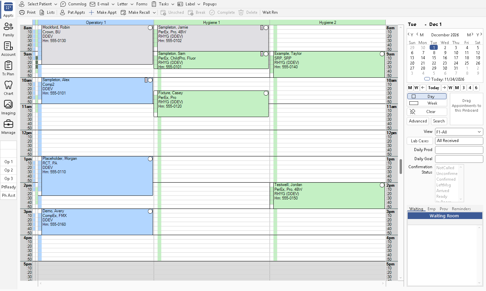

# How Open PMS - Dental differs from Open Dental

Open PMS - Dental is **derived from Open Dental, heavily extended**. It started from Open Dental's public source code at version
24.3.63 (commit `d804c1954`, the last commit of that source) and keeps its database schema, its modules and the way staff work in them.
Most of the program's code is still Open Dental's; what this project adds is a large body of new and rewritten code around it: the
features of later Open Dental versions written again from public documents, a new platform, a new look, new imaging and new tools, and the
tests for all of it. Open PMS - Dental is not affiliated with or endorsed by Open Dental Software, Inc.



## What is different

- **No limits and no licence fees.** The program puts no cap on the number of providers, users, clinics or workstations, and there is
  nothing to pay per provider: there are no registration keys or support-plan checks.
- **No Open Dental HQ dependencies.** No eServices, registration keys, update servers or help browser; nothing calls Open Dental
  Software's servers, and `NoHqTests` checks that on every test run ([decoupling-plan.md](decoupling-plan.md), [NoHqTests/](../NoHqTests/)).
- **Open code for Open Dental's closed parts.** Open Dental shipped several parts of the program only as closed DLLs, without source.
  Each is rebuilt as open code or removed on purpose: the EHR features of `EHR.dll`, rebuilt from public specifications, with the clinical
  quality measures moved to CMS's 2027 catalog ([ehr-rebuild-plan.md](specs/ehr-rebuild-plan.md)); `ODCrypt.dll`, rebuilt as the open
  `ODCrypt` project; the vendor links of `Bridges.dll` (QuickBooks Online, Microsoft 365, USPS, CareCredit, PostcardMania), now source in
  the business layer; the `Sparks3D` tooth chart engine, replaced by the new WPF chart; `ImagingDeviceManager.dll`, replaced by the native
  capture projects; the needed parts of `CDT.dll` moved into open code. Removed with their features: the help browser
  (`OpenDentalHelp.dll`), the cloud edition (`VirtualWeb.dll`) and the local REST API (`ODApi.dll`); the five launches of `VBbridges.dll`
  say the link is not available, and Suni sensors capture through Suni's TWAIN driver
  ([third-party-binaries-audit.md](third-party-binaries-audit.md)). Nothing was decompiled.
- **Open Dental features through 26.2, re-implemented.** Open Dental's public source stops at 24.3.63. The features of 24.4 to 26.1 and the
  chosen 26.2 changes are written again from Open Dental's public manual, release notes and database documents, on the Open Dental 26.2.0
  schema ([features-24.4.md](specs/features-24.4.md) to [features-26.1.md](specs/features-26.1.md),
  [schema-changes-24.3-to-26.1.md](specs/schema-changes-24.3-to-26.1.md)).
- **.NET 10, 64-bit, self-contained.** The program, its libraries, tools and services moved from .NET Framework 4.8 (32-bit) to .NET 10
  x64, with the runtime in the program folder; the Middle Tier is an ASP.NET Core server ([net10-plan.md](specs/net10-plan.md)).
- **A new look.** Segoe UI 9 pt everywhere, Fluent icons for every button picture, colour tokens, the program's own window frame, every
  window laid out again on one spacing grid, calendars in the new style, a vector progress ring and keyboard focus without flicker
  ([ui-refresh-plan.md](specs/ui-refresh-plan.md); [UI-CAL](port-notes/UI-CAL.md), [UI-LOAD](port-notes/UI-LOAD.md),
  [UI-FOCUS](port-notes/UI-FOCUS.md)).
- **A new 3D tooth chart.** The tooth chart is drawn in WPF with Helix Toolkit, in place of the DirectX 9 and OpenGL engines, with free
  text and orthodontic hardware ([wpf-tooth-chart-plan.md](specs/wpf-tooth-chart-plan.md)).
- **Native imaging capture.** Open-source TWAIN scanning with the 64-bit data source manager, native sensor capture with 16-bit X-rays once
  a test capture has verified the device, intraoral camera and video capture, and an in-house DICOM reader
  ([imaging-capture-design.md](imaging-capture-design.md), [CAP](port-notes/CAP.md), [IMG-TESTCAP](port-notes/IMG-TESTCAP.md),
  [intraoral-capture-setup.md](imaging/intraoral-capture-setup.md), [dicom-reader.md](imaging/dicom-reader.md)).
- **Inventory and routine maintenance tracking**, new in this project ([inventory-tracking.md](specs/inventory-tracking.md),
  [routine-maintenance.md](specs/routine-maintenance.md)).
- **Security on the client side.** Database connections over the network are encrypted and verified against the office's own certificate
  authority, with the program's own database account and its password kept with Windows DPAPI
  ([db-connection-security.md](specs/db-connection-security.md), [server-side guide](db-connection-security.md)); updated libraries,
  WebView2 in place of the Internet Explorer control ([roadmap](roadmap.md#done-in-the-next-version)).
- **Open all the way down.** Every file the setup installs has published source: PDFsharp/MigraDoc and the spell checker are built from
  their source, closed libraries are rebuilt in the open or removed ([third-party-source-builds.md](third-party-source-builds.md),
  [third-party-binaries-audit.md](third-party-binaries-audit.md)).
- **Tests.** 128 test projects under `tests/`, about 269,000 lines, all new, run on scratch databases with synthetic data; next to Open
  Dental's own `UnitTests` and `UnitTestsCore` (about 2,000 test methods at the fork point), which are kept and run on every full check.
  Together about 11,500 test methods today ([testing.md](testing.md)).

## What stayed

- **The database.** The schema follows Open Dental's (26.2.0), and an Open Dental 24.3.63 or 25.3.48 database can be adopted
  ([adoption-runbook.md](adoption-runbook.md)). Names that installations depend on keep Open Dental's spelling: the database,
  `FreeDentalConfig.xml`, the Middle Tier's service names and internal type names ([RENAME](port-notes/RENAME.md)).
- **The way staff work.** The same modules (Appointments, Family, Account, Treatment Plan, Chart, Imaging, Manage), the same windows and
  the same workflows, in the new look.
- **The license and the credit.** The GNU GPL v2 or later (GPL v3 as distributed with PDFsharp and MigraDoc), with every Open Dental
  copyright line and GPL notice kept ([NOTICE](../NOTICE), [LICENSE](../LICENSE)).

## What was removed

1,206 of Open Dental's code files have no counterpart any more (about 180,000 hand-written lines). Most of them are Open Dental
Software's own services and internal tools: the eServices and web service clients (Web Sched, mass e-mail, e-mail hosting, the mobile web),
registration keys and resellers, the update servers, bug submission, the job manager and the company's internal tools. A file rewritten
so far that less than half of it is left also counts here, with its new version counted as new.

## The numbers

Measured at commit `1616a3683` (November 24, 2026) against the fork point `d804c1954` (Open Dental 24.3.63.0) with
[tools/ForkMeasure/measure_fork.py](../tools/ForkMeasure/measure_fork.py):

| Part | Lines | Unchanged from Open Dental | Strict (lines of 25+ characters) | New or rewritten lines |
|---|---:|---:|---:|---:|
| Hand-written code, all projects | 1,407,829 | 60.7% | 56.7% | 552,670 |
| The program (`OpenPmsDental`, `OpenPmsDentalBusiness`, `WpfControlsOD`) | 822,434 | 80.8% | 78.4% | 157,904 |
| Tests (`tests/`) | 269,283 | 0.8% | 0.7% | 267,245 |
| Tools (`tools/`) | 55,747 | 0% | 0% | 55,747 |
| Native imaging (`ImagingCapture`, `ImagingDeviceManager`, `OpenPmsDentalHelper32`) | 35,836 | 0% | 0% | 35,836 |
| Generated files (designer files, `Crud/`, the init SQL, `AssemblyInfo.cs`) | 369,562 | 76.7% | 73.6% | 86,193 |

- **New files:** 3,242 hand-written code files (3,497 counting generated ones). **Removed:** 1,206 Open Dental code files, 241,162 lines
  (179,741 hand-written).
- **For comparison:** Open Dental at the fork point has 6,187 code files and 1,449,417 lines (1,071,221 hand-written).
- **In short:** about 80% of the program itself is Open Dental's code, unchanged apart from the product name; about 158,000 lines of the
  program are new or rewritten; the tests, tools and native imaging (about 360,000 lines) are almost entirely new.

**How it is measured.** Code files only (`.cs .xaml .sql .ps1 .psm1 .py .js .cpp .h .vb .cshtml .css .html`). A line counts when it has a
letter or a digit; whitespace is removed and the product rename is folded (`OpenPmsDental*` and `OpenDent*` names become one token), so a
line changed only by the rename still counts as Open Dental's. Each file is paired with its Open Dental file by git's rename and copy
detection (50% similarity) or by its path; a line is unchanged when the paired Open Dental file holds the same line. Generated files are
reported apart. The measure is line based: a moved line counts as unchanged, a line with one changed character as rewritten. Details in
[tools/ForkMeasure/README.md](../tools/ForkMeasure/README.md).

**Run it again** from the repository root (Python 3 and git, about a minute):

```
python tools/ForkMeasure/measure_fork.py d804c1954 1616a3683
python tools/ForkMeasure/measure_fork.py d804c1954 HEAD
```

## Screenshots

The pictures in [screenshots/](screenshots/) are the program's own windows with fictional data only; how they are made is in
[screenshots/README.md](screenshots/README.md).
