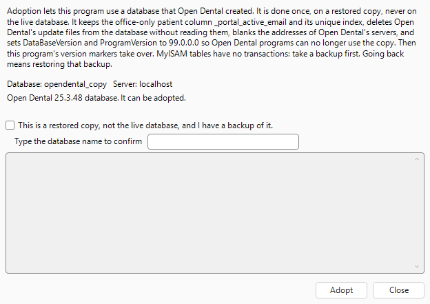

# Move from Open Dental

Your Open Dental database becomes an Open PMS - Dental database: patients, appointments, charts, accounts, insurance and images stay. This
is called **adoption**. It runs once, on a copy, never on the live database, and the original stays untouched as your way back.

## Which Open Dental versions

| Open Dental version of your database | Can it be adopted? |
|---|---|
| 24.3.63 | Yes |
| 25.3.48 (also a 25.3.54 install whose database is labelled 25.3.47) | Yes |
| 26.2 (Open Dental's current stable version) | **Not yet.** Open PMS - Dental follows the 26.2.0 schema, but adoption accepts only the versions above so far. |
| Any other version | No: update Open Dental to a version above first |

Your version is in Open Dental under Help > About, and in the `DataBaseVersion` preference.

## Steps

For an office, follow the full procedure, [the adoption runbook](../adoption-runbook.md): it has every command, what to expect, a second
person's checks and the rollback. In outline:

1. **The week before:** check the server and the database, rehearse on a copy, and list the settings to enter again
   ([runbook, preparation](../adoption-runbook.md#0-preparation-the-week-before)).
2. **On the day:** stop and uninstall Open Dental on every workstation and its services
   ([step 2](../adoption-runbook.md#2-stop-and-uninstall-the-open-dental-services-and-clients)).
3. **Back up, then copy** the database on the server ([step 3](../adoption-runbook.md#3-back-up-and-copy)).
4. **Adopt the copy** with `AdoptionValidation adopt` ([step 4](../adoption-runbook.md#4-adopt-the-copy-without-starting-the-program)).
   A small office without the tools can use the program's **Adopt Database** window instead (above): it opens at the program's start on an
   Open Dental database of a version above. Tick that it is a restored copy, type the database name, and click **Adopt**.
5. **Validate**, start the program, enter the stored passwords again, and switch every workstation
   ([steps 6 to 8](../adoption-runbook.md#6-validate-the-adopted-copy-then-start-the-program)).
6. **Point your other programs** (reports, portals, imaging bridges) at the adopted database
   ([step 9](../adoption-runbook.md#9-point-the-other-programs-at-the-adopted-database)), then go live.

After adoption, Open Dental can no longer open the copy. Going back means [the rollback](../adoption-runbook.md#rollback): the untouched original.

## More

- What adoption changes, step by step: [Adopting a database](../release-process.md#adopting-a-database).
- How Open PMS - Dental differs from Open Dental: [differences.md](../differences.md).
