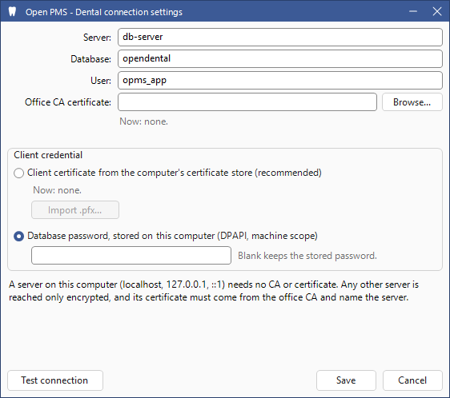

# Set up a new database

For a new office that does not move from Open Dental: an empty database with everything the program needs to start, and the program
connected to it. An office that moves from Open Dental follows [Move from Open Dental](move-from-open-dental.md) instead.



## Steps

1. **Install MariaDB 10.11** on the database server, with these lines in the `[mysqld]` section of its settings file (`my.ini` on Windows):

   ```ini
   [mysqld]
   sql_mode=
   default-storage-engine=MyISAM
   max_allowed_packet=40M
   ```

2. **Create an empty database** in the `mariadb` client (or HeidiSQL's query tab):

   ```sql
   CREATE DATABASE opendental CHARACTER SET utf8mb3 COLLATE utf8mb3_general_ci;
   ```

3. **Load the new-database file** that comes with every release, `db\init\new-database.sql` (in the source and the release's source archive):

   ```powershell
   mariadb -u root -p opendental < db\init\new-database.sql
   ```

   It takes under a minute and creates every table at the current schema (Open Dental 26.2.0 and this program's own tables).
4. **Create a database account for the program** (not `root`), with rights on that database only.
5. **Install the program** on each workstation ([Installing in an office](../admin/installing.md#workstations)). Setup opens the
   connection settings tool, `OpenPmsDentalDbSettings.exe` (above): enter the **Server**, **Database** and **User**, then the password, or
   the office CA and client certificate for a server over the network ([securing the connection](../admin/db-connection-security.md)). Click
   **Test connection**, then **Save**.
6. **Start the program.** It logs on as `Admin` and asks for a new password straight away.
7. **Enter the practice's settings:** practice name, address and phone, providers (two placeholders, `DOC` and `HYG`, are there to rename),
   operatories, fee schedules, the images folder (**Setup** > **Data Paths**) and your procedure code descriptions (the file names the codes only).

## More

- What the file holds and how it is regenerated: [db/README.md](../../db/README.md).
- The server settings explained: [Installing in an office](../admin/installing.md#database-server).
