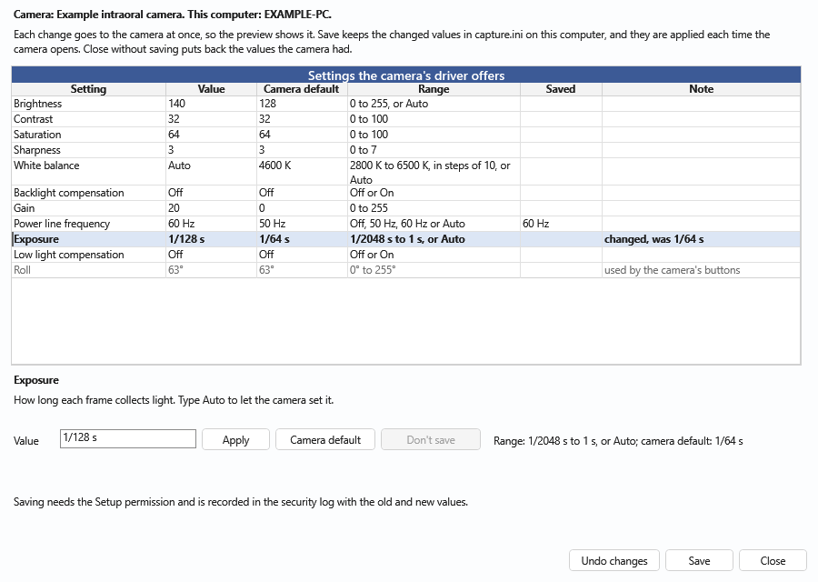
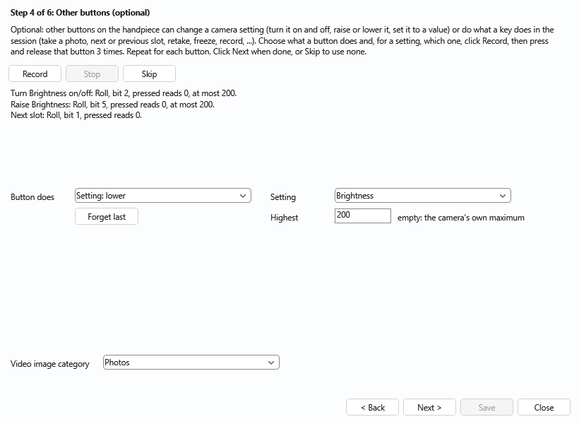

# Set up the intraoral camera

Set up an intraoral camera once on each computer: its picture (brightness, exposure, white balance and the other settings its driver
offers), and what each button on the handpiece does. Everything is saved on the computer and comes back each time the camera opens.

## Picture settings

1. Connect the camera, select a patient, open **Imaging** and start a **Camera** session.
2. Click **Camera settings...**, then **Picture settings...** (needs the Setup permission).
3. Click a setting, type or pick its value (for example **60 Hz**, **1/128 s** or **Auto**) and click **Apply**. The live picture changes at
   once. **Camera default** puts back the camera's own value.
4. Click **Save**. The values are applied each time the camera opens, and the change is recorded in the security log.
   **Close** without saving puts back the values the camera had. **Don't save** removes a saved value.

A setting the camera's buttons are read from is shown greyed out and is never changed here.

## Camera buttons (Learn)

1. In **Camera settings...**, click **Learn button...**, and follow the steps with the camera in your hand.
2. **Baseline A** (held, no button pressed) and **Baseline B** (resting in its holder, optional), then the **Capture key**: press the photo
   button three times.
3. **Other buttons** (optional): for each other button, choose in **Button does** what it does, then click **Record** and press it three
   times:
   - **Setting: turn on/off**, **raise**, **lower** or **set to a value**: also pick the **Setting** (for example the one that drives the
     camera's light) and, if you like, its **Highest** value.
   - **Program: take a photo**, **next slot**, **previous slot**, **retake the last photo**, **freeze or go live** and the other session
     actions: the button does what the key does.
4. **Level input** (optional): the holder. Ticking **Also turn [setting] off while resting** turns, for example, the light off while the
   camera rests.
5. On the test page, press each button: its tile counts the presses. Click **Save**.

## More

- Take photos: [Take intraoral photos](take-intraoral-photos.md).
- The reference: [camera settings](../specs/imaging-capture-design.md#87-camera-settings-and-review-flags),
  [Learn](../specs/imaging-capture-design.md#85-learn-tool-and-button-test),
  [button actions](../specs/imaging-capture-design.md#86-level-inputs-and-auto-preview) and
  [capture.ini](../specs/imaging-capture-design.md#93-local-file-captureini).
