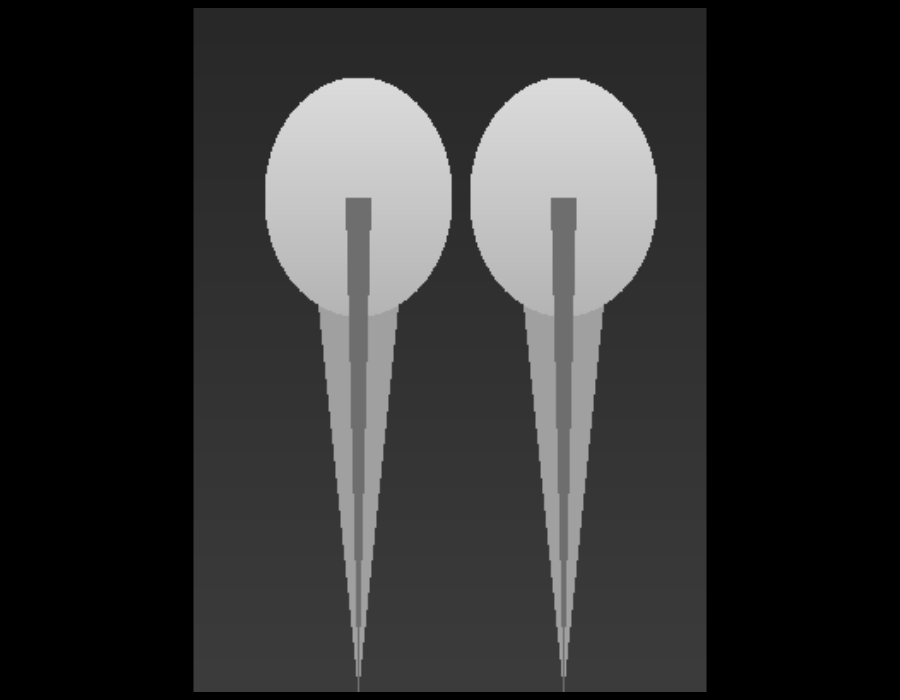

# Show images on a second monitor

Show the patient an image, a mount, an X-ray as it arrives, the camera or a chart on the monitor that faces them. Each of these opens in
an ordinary window with the usual minimise, maximise and close buttons: drag it to the other monitor and maximise it there. There is no
special setting; with two monitors in extended mode, Windows does the rest.

## Open a visual in its own window

| Visual | How |
|---|---|
| An image or a mount (Imaging) | Drag the bar above the image out of the module, or double-click an image to open the image viewer |
| An X-ray as it arrives | In the capture session, double-click **Last image** ([Take X-rays](take-x-rays.md)); it follows each new image and closes with the session |
| The intraoral camera | In the camera session, press **F11** ([Take intraoral photos](take-intraoral-photos.md)); its close button puts the session back in the module |
| The tooth chart | Chart module, the big tooth chart |
| The graphical perio chart | Perio chart > **Graphical** |

## Move it to the other monitor

- Drag the window by its title bar to the other monitor, or press **Win+Shift+Left/Right**.
- Maximise it there (**Win+Up**, or the maximise button); the visual grows with the window.

## More

What each window does and why: [visuals-in-own-windows.md](../specs/visuals-in-own-windows.md).
