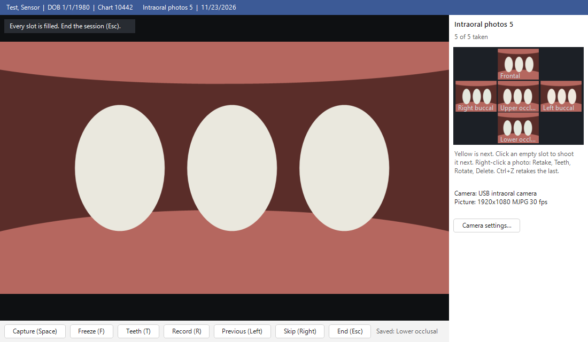

# Take intraoral photos

Take photos with the intraoral camera into a photo mount (intraoral, ortho, before and after) or as quick photos. Each photo is saved as
soon as it is taken.

## Take photos

1. Select the patient and open **Imaging**.
2. Click the arrow of **Camera** and pick a photo mount, or **Quick photos**. **Camera** itself starts the kind of session you used last
   (Ctrl+Shift+P from anywhere in the module).
3. Take each photo with the camera's button, **Capture** or **Space**. With a photo mount the photo fills the yellow slot and the session
   moves to the next one. Click an empty slot to take it next; right-click a photo to retake, rotate or delete it (**Ctrl+Z** retakes the last).
4. Click **End** (**Esc**) when you are done. Changing the patient closes the session.

## Set up (once per computer)

Connect the camera, start a session, click **Camera settings...**, set its picture with **Picture settings...**, and teach the program the
camera's buttons with **Learn button...** (take a photo, a light on and off, next slot and more):
[Set up the intraoral camera](set-up-the-intraoral-camera.md).

## More

- **F11** puts the session in a window of its own, which can be dragged to another monitor and maximised
  ([second monitor](show-images-on-a-second-monitor.md)).
- The camera design: [imaging-capture-design.md](../specs/imaging-capture-design.md#8-camera-capture-design).
