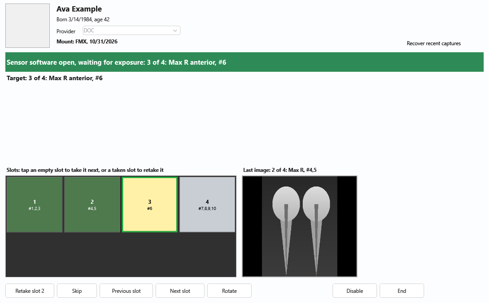

# Take X-rays with a sensor

Take a series (BWX, FMX) or a single X-ray from an intraoral sensor. The capture session shows the patient, the mount's slots and each image
as it arrives, so every X-ray goes into the right slot of the right patient.

## Set up (once per computer)

1. Install the sensor's driver and TWAIN source with the supplier's own installer, and connect the sensor.
2. **Setup** > **Imaging** > **Devices** > **Add**: a **Description** staff will recognise, **Device Type** Twain Radiograph, the
   sensor's **Twain Name** picked from the list, then **Capture settings** and **Save**.
3. Run the device's **Test capture** once; until then images are taken in 8 bits.
4. **Setup** > **Imaging** > **Mounts**: check each mount's slot order, sizes, rotation and tooth numbers.

The details for each step: [the clinic setup runbook](../imaging/intraoral-capture-setup.md#6-set-up-the-imaging-device-in-open-pms---dental).

## Take a series

1. Select the patient, open **Imaging**, and select a category (not a mount).
2. **Mount / Acquire**: pick the mount and the sensor, then **Create Mount and Acquire**. The capture session opens (above).
3. Check the patient's name and the target slot in the green bar, then expose. The image appears in its slot and in **Last image**, and the
   session moves to the next empty slot.
4. To retake, click the slot (or **Retake slot N**); to skip one, **Skip**. Click **End** when the series is done.

**Never re-expose a patient until the images are checked.** If an image seems missing, see
[what to check first](../imaging/intraoral-capture-setup.md#1-rules-that-always-apply).

## More

- Double-click **Last image** to open it in a window of its own, for example on the patient's monitor
  ([second monitor](show-images-on-a-second-monitor.md)).
- A single X-ray: select a category, **Mount / Acquire**, pick only the sensor, **Acquire**.
- Notices, failures and recovery: [the clinic setup runbook](../imaging/intraoral-capture-setup.md#9-notices-and-what-they-mean).
