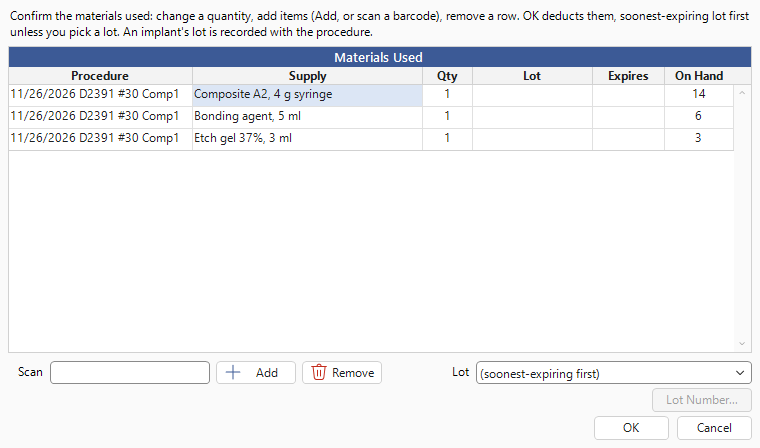
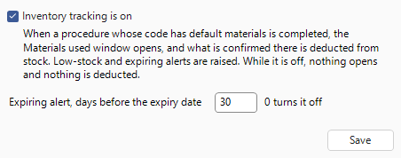
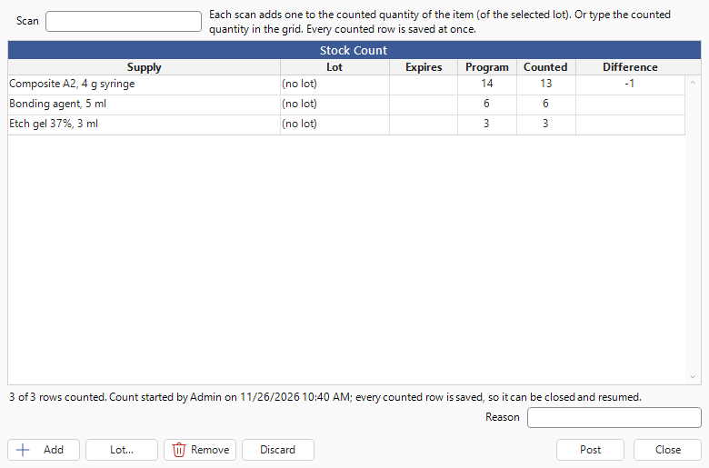

# Track inventory

Stock of supplies goes down by itself when procedures are completed. Scanning a barcode receives orders and counts stock; supplies can be
tracked by lot and expiry date; low stock and expiring lots raise alerts. Tracking is off until you turn it on.

## Turn it on (once)

1. **Manage** module > **Supply Inventory** > **Inventory** > **Setup**: tick **Inventory tracking is on**, set how many days before expiry
   to be alerted, and click **Save** (needs Setup).

   

2. For each supply (**Supply Inventory** > **Supplies**, double-click it): enter its barcode and a **Reorder Level** (the low-stock alert),
   and tick **Tracked by lot and expiry** for supplies with lot numbers, and **Implant (lot on procedure)** to record the lot with the
   patient's procedure.
3. **Inventory** > **Default Materials of Procedure Codes**: give each procedure code the supplies it uses, with quantities.

## Every day

- **Completing a procedure** opens **Materials used** (above) with the code's default materials. Change a quantity, scan or **Add** an item,
  **Remove** one, then **OK**: what is confirmed is deducted, soonest-expiring lot first. Un-completing or deleting the procedure puts it back.
- **Receiving an order:** **Supply Inventory** > **Orders**, select the order, **Receive**. Scan each item as you unpack it (each scan adds one), enter lot
  and expiry for lot-tracked supplies, then **Post**.
- **Alerts:** low stock and lots expiring soon appear in the **Alerts** menu; opening one opens Supply Inventory.

## Count stock

**Supply Inventory** > **Stock Count**. Scan each item (each scan adds one) or type the counted quantity. Each row is saved as it is counted,
so a count can be closed and resumed on any workstation. Enter a **Reason** and click **Post** to write the differences (needs Inventory Adjust).

## More

- **Inventory** > **Usage Report**: quantity and cost used, by item and by procedure code.
- The full design: [inventory-tracking.md](../specs/inventory-tracking.md).
