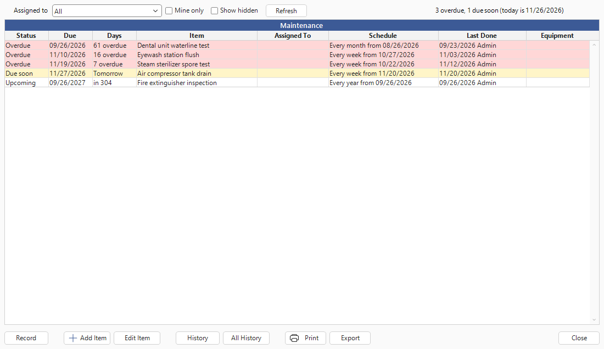
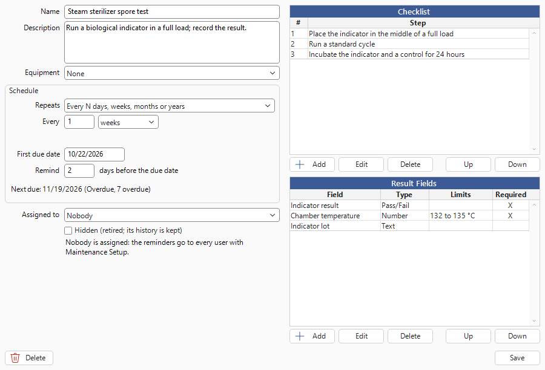
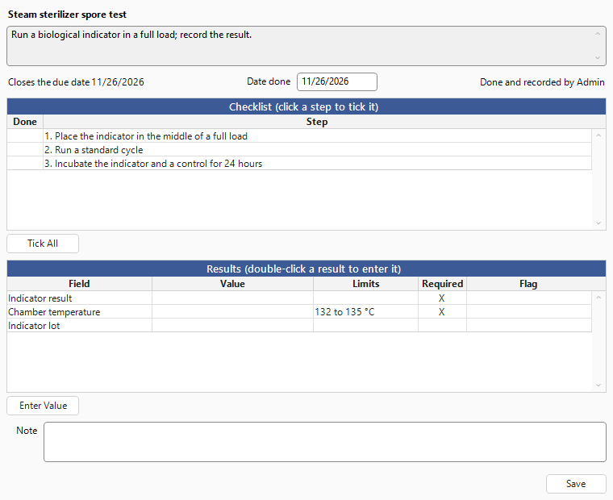

# Track routine maintenance

Keep the office's routines on schedule (a sterilizer spore test, waterline tests, an eyewash flush, any equipment or compliance task) and
keep a record of every time one is done. The list starts empty: the office defines its own items.

## Set up an item (once per routine)

1. **Manage** module > **Maintenance** opens the board. Click **Add Item** (needs Maintenance Setup).
2. Enter the **name**, what to do, the **schedule** (every N days, weeks, months or years; on chosen weekdays; or N units after the last
   time it was done), how many days ahead it shows as **due soon**, and who it is **assigned to** (a user or a user group).
3. Add the **checklist** steps and the **results** to record (pass or fail, a number with limits, text, a date or an attachment). Click **Save**.

## Record that it was done

1. On the board, select the item and click **Record**.
2. Tick the checklist steps, double-click each result to enter it, add a note, and click **Save**. The user and the time are recorded;
   a failed or out-of-range result is flagged.

## Stay on top of it

- The board lists **overdue** items first (red), then **due soon** (yellow), then upcoming. **Mine only** shows your items.
- Overdue and due-soon items also raise **alerts** to the assigned people (or to everyone with Maintenance Setup).
- **History** and **All History** list every completion, with **Print** and **Export** for an inspection. A completion is never deleted;
  its recorder can **Correct** it, and the correction is logged.

## More

The full design: [routine-maintenance.md](../specs/routine-maintenance.md).
